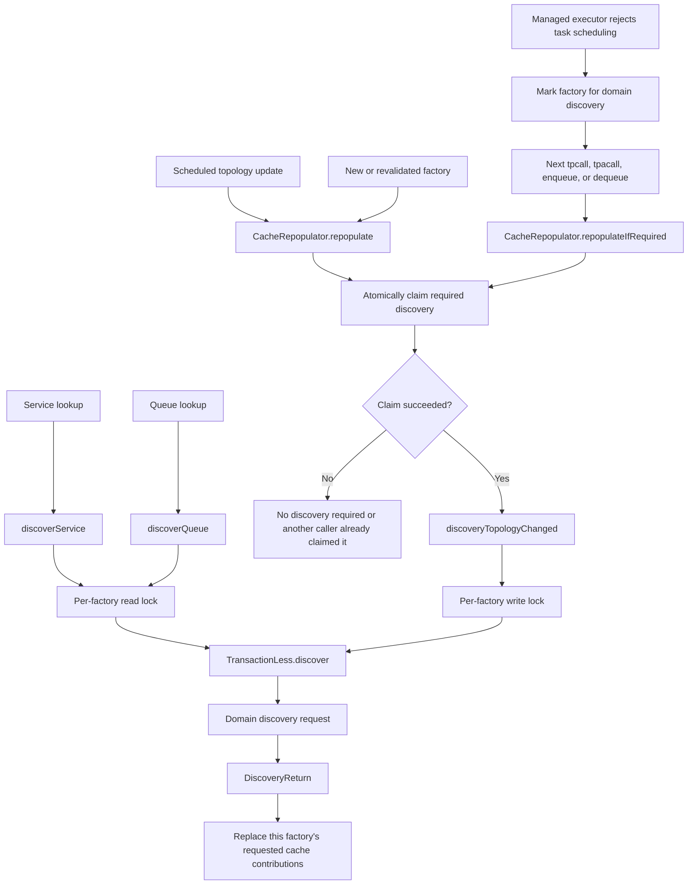
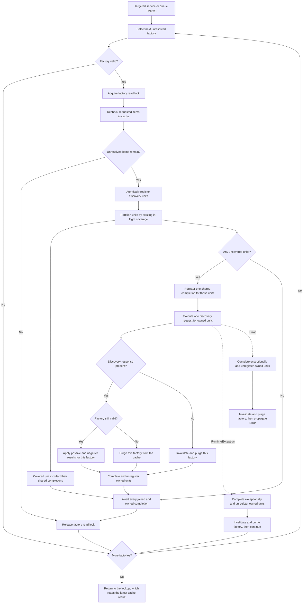
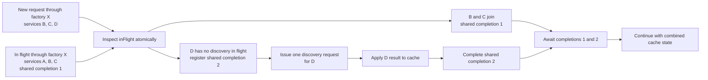
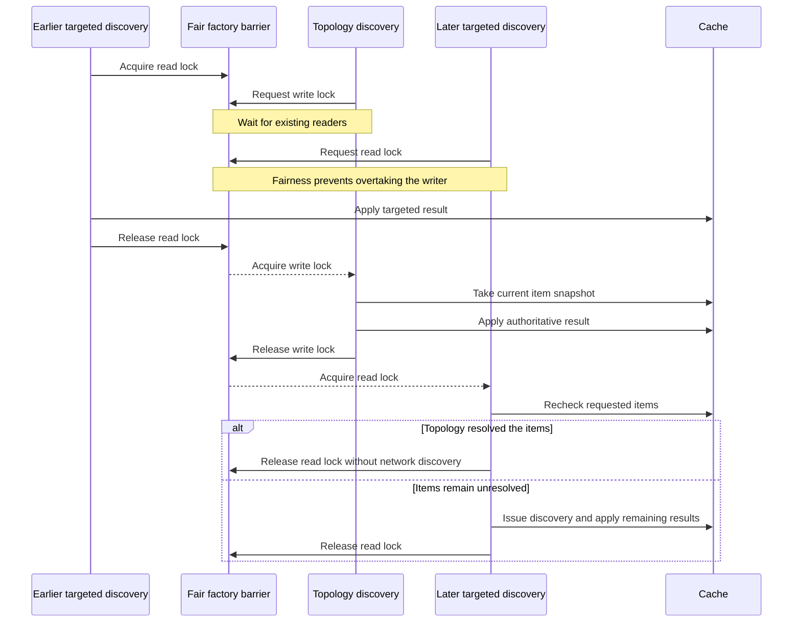

# Domain discovery design

## Problem statement

Without centralized coordination, discovery paths can overlap without sharing their work:

- A targeted service or queue lookup queries all candidate connection factories that the cache has not resolved.
- A topology update queries all cached services and queues through one connection factory.
- Validation can trigger the same topology discovery when a connection factory becomes available.

These overlaps do not create an intrinsic deadlock or resource leak. Each discovery uses a pooled connection and closes the connection handle. However, concurrent cache misses can issue the same network requests repeatedly, consume managed connection handles temporarily, and leave application threads waiting for handles.

Before this change, `CacheRepopulator` held a global lock while it performed network discovery. That lock serialized
discovery for unrelated connection factories. A slow network response therefore delayed discovery through every other
factory. The coordinator removes the global lock and uses a separate barrier for each connection-factory name, so
discovery through unrelated factories can run concurrently.

## Discovery model

A logical discovery resolves a set of service or queue names across a set of connection factories. A service can exist
through many connection factories, one connection factory, or no connection factory. A valid topology provides a queue
through at most one connection factory. If discovery finds the same queue through several factories, the topology is
misconfigured.

Queue discovery still queries every candidate factory. The caller cannot know which factory provides the queue before
discovery, and querying every factory also identifies an invalid topology with several providers. While at least one
provider remains cached, the cache tracks which factories returned positive and negative results. If a topology exposes
the queue through several factories, `QueueCache` selects one valid factory and keeps that selection sticky for the
queue. Enqueue and dequeue operations continue through the selected factory while it remains valid and continues to
provide the queue. This prevents the caller from distributing operations for one logical queue across several factories
while the topology error exists.

The smallest independently tracked unit of discovery is therefore this combination:

```text
(cache type, item name, connection factory)
```

For example, a targeted discovery for service `A` through factories `X`, `Y`, and `Z` covers:

```text
(SERVICE, A, X)
(SERVICE, A, Y)
(SERVICE, A, Z)
```

A later targeted discovery for `[A, B, C]` through factories `X`, `Y`, and `Z` overlaps the first request for these
units:

```text
(SERVICE, A, X)
(SERVICE, A, Y)
(SERVICE, A, Z)
```

The later discovery reuses those results and issues requests for `[B, C]` through each factory where those items remain
unresolved. Each factory remains independent: if only `(SERVICE, A, X)` is still in flight, the caller joins that
operation and can use cached results for `Y` and `Z`.

The current `discoverService(...)` and `discoverQueue(...)` entry points submit one item at a time. The multi-item
example describes the coordinator's internal set model. Topology discovery batches several items, but the topology
barrier orders that work instead of registering it in `inFlight`.

Topology discovery does not join targeted discovery through `inFlight`. The per-factory read/write barrier orders those
operations. A topology discovery waits for targeted work that already holds the read lock. A later targeted discovery
waits for the topology writer and then checks the refreshed cache before it decides whether to issue another request.

When two item sets partly overlap for the same factory, the later discovery joins the overlapping work and issues discovery only for the difference. For example:

```text
In flight: [A, B, C] through X
Requested: [B, C, D] through X
New work:  [D] through X
```

The tracking unit does not determine the wire request size. The coordinator can batch several missing items for the same connection factory into one physical discovery request.

`ConnectionFactoryEntry.getJndiName()` provides the connection-factory identity used by discovery keys and barriers.
Normal pools use their JNDI name. A reverse virtual pool appends its domain ID to the base name. These names must remain
stable and unique for the lifetime of an entry.

## Design invariants

The discovery implementation preserves these invariants:

- All targeted, topology, and validation-triggered discovery goes through one coordinator.
- At most one registered targeted operation owns a specific item, cache type, and connection factory.
- A later targeted discovery joins overlapping work and issues requests only for missing coverage.
- A topology discovery waits for targeted discovery already running through the affected connection factory.
- After a topology discovery becomes pending, new targeted discovery does not overtake it for that connection factory.
- After waiting, a targeted discovery checks the cache again before it issues network work.
- Discovery through unrelated connection factories can proceed concurrently.
- Service lookup orders factories by priority and randomizes factories that have the same priority.
- By default, each service call independently selects from the randomized, priority-ordered factories.
- If transaction stickiness is enabled, service calls in a transaction use its sticky factory when that factory remains
  usable and provides the requested service.
- Queue lookup checks every valid candidate factory and never load balances between multiple discovered providers.
- Queue operations remain sticky to one factory until that factory becomes invalid or stops providing the queue.
- A thread never holds discovery locks for more than one connection factory.
- The coordinator applies discovery results according to the established operation order.
- Exceptional completion always releases registered in-flight coverage so a later request can retry.
- A caller cannot cancel work shared with other callers through the synchronous coordinator API.

The rule against holding several connection-factory locks prevents lock-order deadlocks. To discover an item through several factories, split the logical request into independent per-factory operations and combine their results after those operations complete.

## Discovery flow diagrams

### Discovery entry points

Targeted lookup and topology discovery enter the coordinator through separate methods. Both paths use
`TransactionLess.discover(...)` and apply the returned `DiscoveryReturn` to the cache.



### Targeted discovery

The coordinator processes the unresolved connection factories in list order and releases each factory's read lock
before it moves to the next one. Concurrent callers can still discover through different factories at the same time.
`register(...)` runs while holding `registrationMonitor`, but the coordinator releases that monitor before it performs
network work.



Both branches after registration can apply to one request. The left branch joins discovery units that another
caller already owns, while the right branch registers and executes only the uncovered units. A fully overlapping
request only joins existing work. A partially overlapping request joins existing work and discovers the remaining
units.

### Joining partially overlapping discovery

The discovery key consists of the cache type, item name, and connection-factory name. The coordinator partitions an
unresolved request according to the keys currently in `inFlight`.



For identical targeted requests, every unit joins the existing completion and the second caller issues no network
request. For disjoint targeted requests, each caller owns its complete request. Different cache types or connection
factories produce different discovery keys and do not join.

### Topology ordering for one connection factory

The fair read/write lock forms an ordering barrier. It does not provide cache thread safety; atomic cache operations
provide that separately.



Each connection-factory name has its own barrier. A topology update through factory `X` therefore does not block
discovery through factory `Y`.

## Targeted discovery coordination

For each requested item and candidate factory, the coordinator determines whether an operation already covers the corresponding discovery unit. It then performs these actions:

1. Join futures for discovery units that are already in flight.
2. Atomically register operations for the missing units.
3. Build one request for the newly registered units for that connection factory.
4. Release the coordinator state lock before performing network operations.
5. Execute one new discovery request for the newly registered units.
6. Apply the result, complete the shared future, and conditionally remove each owned registration.
7. Wait for both joined and newly created operations.
8. Return to the lookup, which reads the combined result from the cache.

The atomic registration step prevents two callers from observing the same unit as missing and both starting discovery.

Positive and negative results are both significant. If factory `X` does not provide service `A`, every caller waiting
for `(SERVICE, A, X)` shares that result. The owner applies the cache result before it completes the shared future. A
caller that arrives after registration cleanup checks the cache and observes that the factory has already been checked.

## Topology discovery barrier

A topology update represents a boundary between the previous and current state of one connection factory. Discovery that started before that boundary must finish before the authoritative topology discovery runs.

The required order for one connection factory is:

```text
existing targeted discovery
        ↓
topology discovery
        ↓
subsequent targeted discovery
```

The implementation uses a fair `ReentrantReadWriteLock` per connection-factory name:

- Targeted discovery takes the read lock while it performs network discovery and applies the result.
- Topology discovery takes the write lock while it takes the cache snapshot, performs network discovery, and applies the replacement result.
- Fair ordering prevents new targeted discovery from continually overtaking a waiting topology discovery.

If a targeted request waits behind topology discovery, it checks the refreshed cache after obtaining permission to continue. It issues another network request only for items that the topology discovery did not resolve.

The barrier applies per connection factory. A topology update from `X` must not prevent discovery through `Y` or `Z`.

This ordering avoids topology generation checks. Results from earlier targeted operations are applied before the topology result, and results from later targeted operations are applied after it.

## Topology notification coalescing

`TopologyChangedDoneHandler` coalesces notifications separately for each domain. The first notification schedules
discovery. If more notifications arrive while that discovery is scheduled or running, the handler records one required
follow-up discovery instead of scheduling one task per notification.

If the managed executor rejects a topology task, `TopologyChangedHandlerImpl` marks the matching
`ConnectionFactoryEntry` as requiring discovery. Before the next service call, asynchronous service call, enqueue, or
dequeue operation, `FailedDomainDiscoveryHandler` asks `CacheRepopulator` to claim that pending work. The atomic claim
ensures that concurrent application calls do not all run the same fallback discovery.

Validation also calls `CacheRepopulator` after a new or previously invalid factory becomes valid. This path uses the
same atomic claim and topology discovery barrier.

## Cache responsibilities

The coordinator owns discovery lifecycle and ordering. The cache remains responsible for storing immutable values and applying atomic updates.

Discovery through different factories remains concurrent. If factories `X` and `Y` both provide service `A`, they can update the provider set concurrently. Cache mutations must therefore continue to use atomic `ConcurrentHashMap` operations such as `compute`.

Applying a discovery result must replace only the queried factory's contribution for each queried item:

- A positive result adds or updates that factory as a provider.
- A negative result removes that factory as a provider.
- A result from one factory does not replace providers learned through other factories.

Service lookup retains every discovered provider. It orders factories by service priority and randomizes factories
within each priority. By default, each service call uses the first factory in that randomized, priority-ordered list.
This selection load balances calls among providers that have the same priority.

Transaction stickiness is disabled by default. If you enable it and a call runs in a transaction without an existing
sticky factory, the call selects from the same randomized, priority-ordered list and records the selected factory for
that transaction. Later calls in that transaction use the sticky factory when it remains usable and provides the
requested service. If the sticky factory does not provide the requested service, selection continues through the
randomized, priority-ordered list.

If connection acquisition fails before service invocation and the transaction still permits retry, the caller tries
the next factory in the randomized, priority-ordered list. After service invocation begins, a failure does not cause the
caller to try another provider in the same transaction.

Queue lookup expects one provider but retains all discovery results so it can detect multiple providers and select a
sticky factory. If the selected queue factory becomes invalid or stops providing the queue, the cache removes the
sticky selection and can select another valid provider.

Topology discovery does not purge the factory before it sends the network request. It applies the response as an
ordered replacement for the queried factory and item set. This prevents readers from observing an unnecessarily empty
intermediate state and prevents concurrent updates from being lost between snapshot and purge.

Targeted and topology discovery both use the domain discovery operation and return `DiscoveryReturn`. The original
request identifies every queried discovery unit. If the response omits a requested item, the cache treats that omission
as a negative result for the queried connection factory.

When a service invocation returns `TPENOENT`, the failover path removes only the responding connection factory's
contribution for that service. Providers learned through other factories remain available. A later lookup can rediscover
the removed contribution if that factory remains a candidate.

## Failure handling

For targeted discovery, the coordinator always completes and unregisters owned work after a `RuntimeException` or an
`Error`. Callers that joined the operation observe the same failure instead of waiting indefinitely. The per-factory
boundary then handles that failure consistently for both the owner and the joining callers.

Targeted discovery handles failures as follows:

- If discovery returns no response, the coordinator invalidates and purges that factory before it continues.
- If discovery throws any `RuntimeException`, the coordinator invalidates and purges that factory and continues with
  the remaining candidate factories.
- If discovery throws an `Error`, the coordinator invalidates and purges that factory, releases its registered work,
  and propagates the error unchanged.
- If another concurrent operation invalidates the factory before a successful response is applied, the coordinator
  purges the factory instead of restoring its cache entries.

Topology discovery also contains every `RuntimeException` after it invalidates and purges the factory. It propagates an
`Error` unchanged after invalidation and cleanup. A missing response invalidates and purges the factory.

The application-facing API validates required service and queue arguments before discovery begins. Discovery therefore
treats a `RuntimeException` as a local inability to resolve a usable remote provider rather than as invalid application
input. If no other provider remains, the empty lookup result becomes `TPENOENT`.

## Component responsibilities

The implementation uses this separation:

```text
Discovery coordinator
├── tracks in-flight discovery coverage
├── joins overlapping targeted discovery
├── orders topology discovery against targeted discovery
├── executes network discovery
└── applies ordered results to the cache

Cache
├── provides immutable snapshots
├── atomically merges one factory's results
├── atomically removes one factory's results
└── keeps queue operations sticky to one discovered factory
```

With this separation:

- `CacheRepopulator` no longer needs a global network-operation lock.
- Lookup classes no longer coordinate discovery races.
- Topology handling continues to coalesce repeated notifications, but delegates discovery ordering to the coordinator.
- Cache code does not track in-flight network work.

## Benefits

The coordinator provides these benefits:

- Concurrent misses for the same item share network operations.
- Partly overlapping requests issue discovery only for their missing portions.
- Topology and targeted discovery have an explicit and testable order.
- Unrelated factories and unrelated items can still make progress concurrently.
- Discovery load is bounded by unique missing discovery units rather than by the number of application callers.
- The design centralizes concurrency rules instead of adding local race corrections to each discovery and cache path.

For example, without coordination, 100 callers that miss service `A` while five factories are available can issue up
to 500 network operations. Coordinated discovery reduces the initial work to one operation per factory. Concurrent
callers join those operations, and later callers use the cached resolution.

## Costs and constraints

The coordinator introduces these costs:

- It must atomically register, complete, and remove overlapping operations.
- It must combine partial success and failure across several factories.
- It must clean up registrations after normal and exceptional completion.
- A targeted lookup can wait for a larger in-flight batch that covers the same item.
- The cache needs per-factory replacement operations that preserve results from other factories.

The implementation minimizes the scope of synchronization. It does not perform network operations while holding the
coordinator state lock. Per-factory discovery locks intentionally remain held during their network operations because
they establish ordering for that factory.

The coordinator retains one barrier for every distinct connection-factory name that it observes, including reverse
virtual factory names. It does not remove a barrier when an entry departs because another thread can still hold or wait
for that barrier. Barrier storage therefore follows the number of distinct factory names observed during the process
lifetime rather than only the number of currently active factories.

## Implementation status

The implementation now:

- Routes targeted, topology, and validation discovery through `DiscoveryCoordinator`.
- Uses the domain discovery request for both targeted and topology discovery.
- Registers complete targeted item sets before network operations begin.
- Shares overlapping in-flight discovery and queries only missing discovery units.
- Uses a fair per-factory read/write barrier to order topology discovery.
- Applies positive and negative results as per-factory cache replacements.
- Contains discovery runtime failures at the affected factory and propagates only `Error`.
- Removes only the responding connection factory's service contribution after `TPENOENT`.
- Preserves priority-based service selection and random load balancing among equal-priority factories.
- Applies transaction stickiness only when configuration enables it; the default remains non-sticky selection.
- Tracks checked factories for services and queues while a provider remains cached.
- Keeps each queue sticky to one valid factory and logs when discovery finds multiple providers.
- Removes the former global `CacheRepopulator` network-operation lock.

The synchronous coordinator API does not expose its internal futures. A caller therefore cannot cancel shared network
work when it stops waiting.

## Concurrency tests

The test suite must verify these scenarios deterministically:

- Identical targeted discoveries share one network request per factory.
- Partly overlapping item sets issue discovery only for the set difference.
- Overlap is calculated independently for each connection factory.
- Different factories can perform discovery concurrently.
- Topology discovery waits for targeted discovery already running through the same factory.
- A pending topology discovery prevents later targeted discovery from overtaking it.
- A targeted request waiting behind topology discovery checks the cache before issuing another request.
- Topology discovery for one factory does not block targeted discovery through another factory.
- A negative result is shared by every waiting caller.
- A runtime discovery failure is contained and releases its registered coverage for a later replacement entry.
- An `Error` releases registered coverage and propagates unchanged.
- Cleanup from an older operation cannot remove a newer registration.
- Callers cannot cancel a shared discovery through the synchronous coordinator API.
- Applying a negative result for one factory preserves providers discovered through other factories.
- Concurrent updates through different factories do not lose either factory's result.

The integration suite verifies these combined behaviors:

- Service calls across many service names continue while topology events repeatedly replace provider sets.
- Default non-sticky selection sends calls through multiple equal-priority factories.
- After topology changes stop, normal lookup resolves provider moves and the cache converges on the final topology.
- Targeted lookups that arrive during topology discovery use its result without issuing redundant network discovery.
