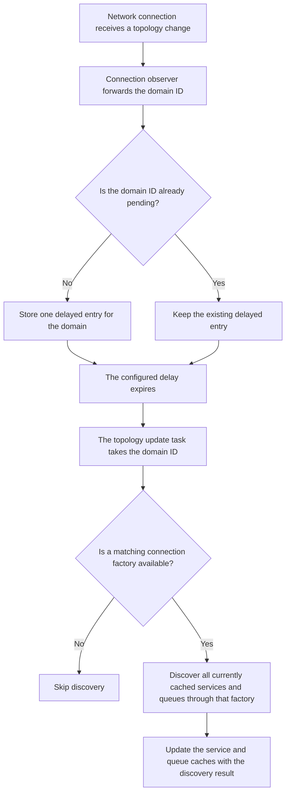

# Topology change handling

Casual Caller listens for topology change notifications from each connected Casual domain. A notification identifies
the domain whose topology changed. Casual Caller uses that domain ID to refresh the cached service and queue information
for the matching connection factory.

## Processing flow

The following diagram shows how Casual Caller handles a topology change notification:



`ConnectionFactoryEntryStore` registers as a connection observer for each usable connection factory. When it receives a
topology change notification, it forwards the notification's `DomainId` to `TopologyChangedHandlerImpl`.

`TopologyChangedHandlerImpl` starts one topology update task after `ConnectionFactoryEntryStore` supplies access to the
current connection factory entries. The task waits for delayed domain IDs and processes them sequentially. Application
calls do not perform or wait for topology change discovery.

## Accumulation behavior

`AccumulatingTopologyUpdateStore` limits repeated topology change notifications without losing notifications for other
domains:

- The store holds at most one pending entry for each `DomainId`.
- The first notification for a domain starts that domain's delay window.
- Additional notifications for the same domain do not replace the entry or restart its delay.
- After the consumer takes the entry, a later notification can create a new delayed entry for that domain.
- Different domains have independent delayed entries.
- The store orders entries by eligibility time. It does not define an insertion order for entries that become eligible
  at the same time.

This behavior bounds the pending work by the number of unique domains, even when a domain sends many notifications in a
short period.

## Domain discovery and cache updates

When a delayed domain ID becomes eligible, the topology update task performs the following work:

1. It obtains the current connection factory entries from `ConnectionFactoryEntryStore`.
2. It finds the entry whose connected domain matches the notification's `DomainId`.
3. It obtains the names of all services and queues currently known by the cache.
4. It issues one domain discovery request through the matching connection factory outside any application transaction.
5. It stores the service and queue details returned by discovery for that connection factory.

If no current connection factory matches the domain ID, the task skips discovery. This case can occur when the
connection disappears before the delayed notification becomes eligible. Connection validation performs discovery after
the connection becomes usable again.

If connection allocation or discovery fails with a `ResourceException`, Casual Caller invalidates the connection factory
entry. The periodic connection validator later attempts to validate the entry and repopulate the cache. An unexpected
failure while handling one domain is logged and does not stop the task from processing later domain IDs.

## Delay configuration

The default accumulation delay is 1,000 milliseconds. You can configure it with either of the following settings:

- Set the `CASUAL_CALLER_TOPOLOGY_CHANGED_DELAY` environment variable to a duration in milliseconds.
- Set `topologyChangeDelayMillis` in the Casual Caller configuration file.

For example:

```json
{
  "topologyChangeDelayMillis": 5000
}
```

A longer delay combines more notifications for the same domain but postpones cache updates. A shorter delay updates the
cache sooner but can issue discovery more frequently when topology changes arrive in bursts.

## Shutdown behavior

Casual Caller does not need to drain pending topology updates during domain shutdown because shutdown terminates the JVM.
Before the topology update task waits for another domain ID, it checks whether the local domain is shutting down. The
task does not attempt to drain the accumulated topology updates as part of transaction drainage.
